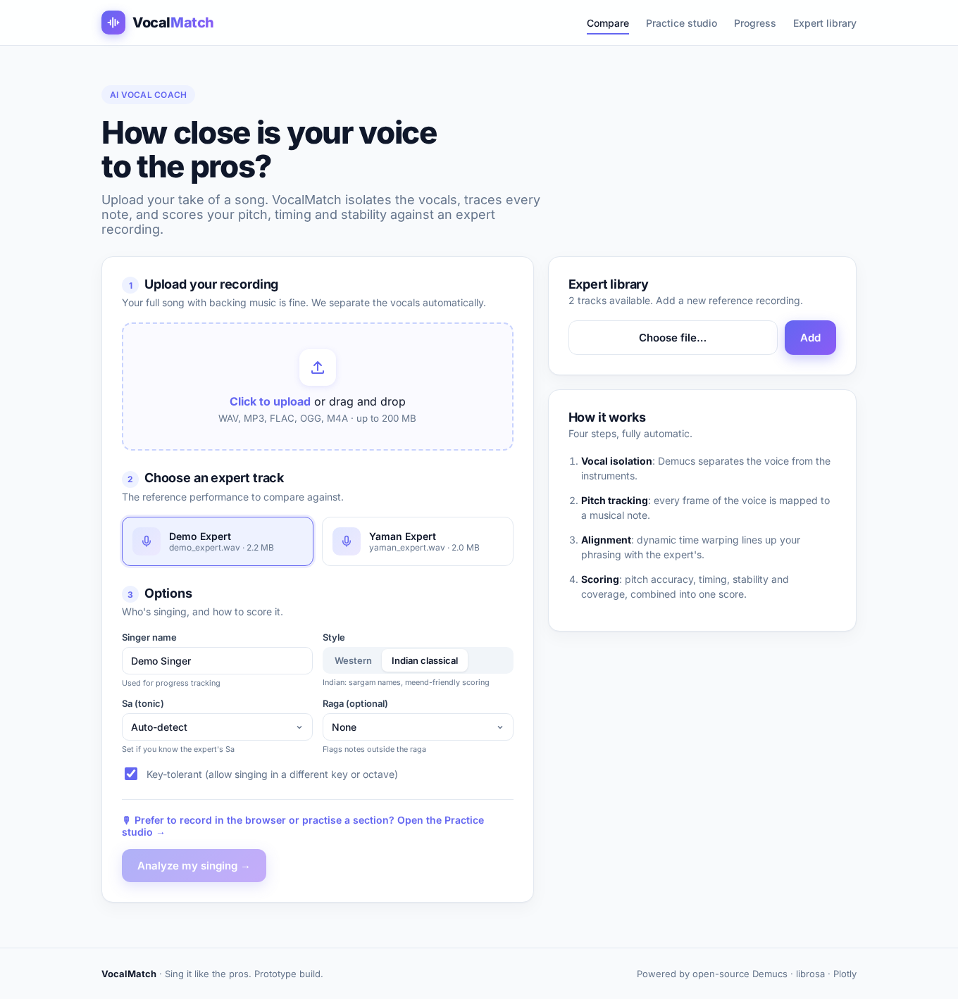
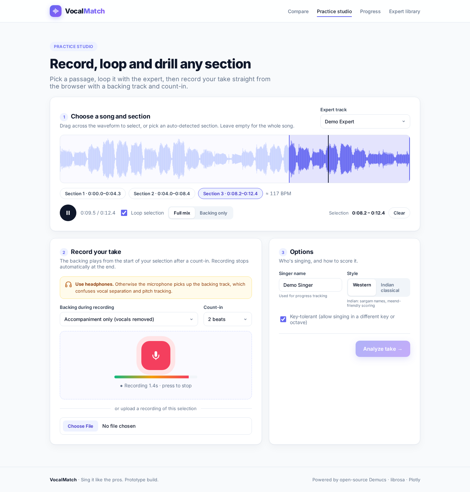
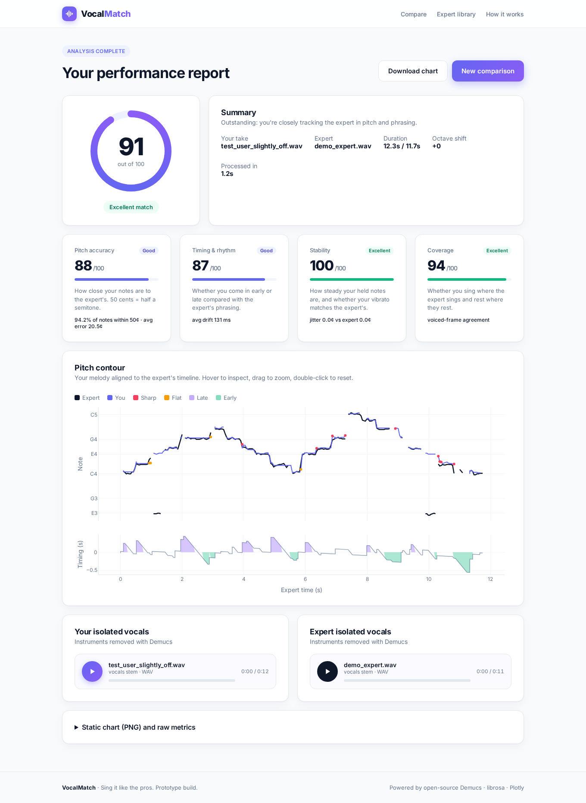
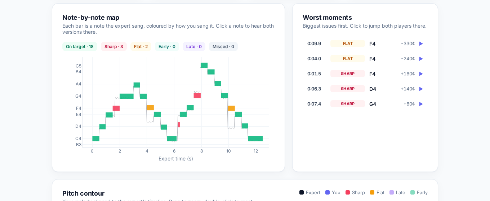
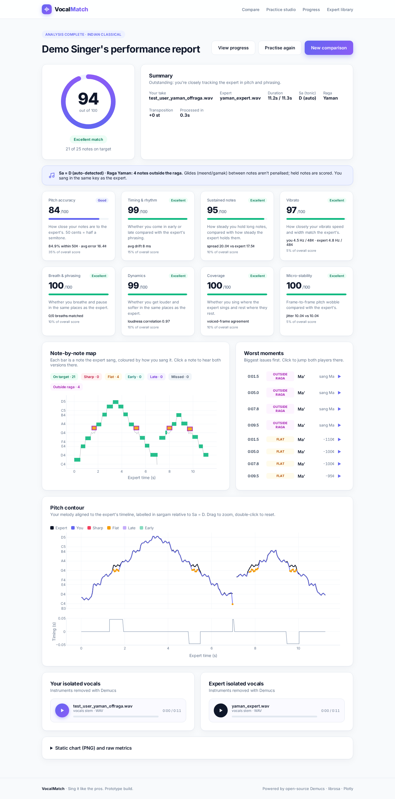
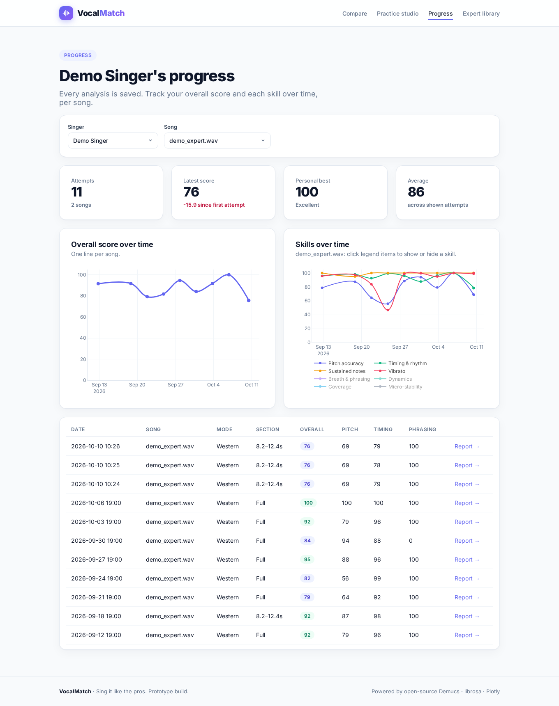

# VocalMatch

Score how closely your singing matches an expert recording of the same song.

VocalMatch isolates vocals (Demucs `htdemucs`), tracks pitch (librosa pYIN), aligns with DTW, and returns pitch / timing / voice metrics plus note-by-note feedback. Two front ends share `analysis.py`:

| Front end | Entry | Best for |
| --- | --- | --- |
| **Gradio** (HF Space) | `gradio_app.py` | Free **ZeroGPU** Spaces |
| **Flask** (full UI) | `app.py` | Local / Docker / Render |

> **GitHub Pages cannot host this app.** Docker Spaces are **paid** on some HF accounts; the free path is a **Gradio** Space on **ZeroGPU** hardware (CPU Basic may be disabled).

## Screenshots

| Home | Practice studio | Results |
| --- | --- | --- |
|  |  |  |

| Note feedback | Indian / raga | Progress |
| --- | --- | --- |
|  |  |  |

## Features

- **Compare** — upload or record against a library track (`experts/`)
- **Key-tolerant scoring** — global transposition search (default on)
- **Note-by-note feedback** — good / sharp / flat / early / late / missed
- **Gradio Space** — microphone recording, Plotly pitch chart, isolated vocals
- **Flask practice studio** (`/studio`) — waveform, sections, loop, accompaniment, count-in
- **Indian classical mode** — Sa detect, sargam labels, ragas (Yaman, Bhairav, Bhupali, Desh, Kafi, Bilawal)
- **Voice metrics** — steadiness, vibrato, phrasing, dynamics
- **Progress** (`/history`, Flask) — SQLite attempt history

## Requirements & ZeroGPU constraints

| Constraint | Guidance |
| --- | --- |
| **Python** | ZeroGPU supports **3.10.13** and **3.12.12** (Space YAML uses `python_version: "3.12"`) |
| **Gradio** | **4+** (this repo pins **5.42.0**) |
| **PyTorch** | ZeroGPU needs **≥ 2.8.0** (see [ZeroGPU docs](https://huggingface.co/docs/hub/spaces-zerogpu)); do **not** pin 2.4.x |
| **GPU decorator** | Demucs runs under `@spaces.GPU(duration=180)`; decorator is a no-op off ZeroGPU / CPU fallback |
| **Quota** | Default GPU slice is 60s; we request **180s** for cold Demucs. Free accounts get limited daily ZeroGPU minutes |
| **ffmpeg** | Listed in `packages.txt` for Spaces; install locally via apt |

**RAM / time (CPU local or Docker):** ≥4 GB (8 GB preferred). Short demo (~10–15 s): **30–90 s** cold, **5–20 s** cached. On ZeroGPU, separation is much faster once the GPU is granted (queue + quota still apply).

## Local setup

```bash
sudo apt-get update && sudo apt-get install -y ffmpeg libsndfile1

python3 -m venv .venv
source .venv/bin/activate
pip install -U pip
# CPU torch first (satisfies the torch>=2.8 pin without pulling CUDA wheels)
pip install torch==2.8.0 torchaudio==2.8.0 --index-url https://download.pytorch.org/whl/cpu
pip install -r requirements.txt

python make_test_audio.py   # optional; regenerates experts + test_user_*.wav

# Flask (full UI)
python app.py
# → http://localhost:7860

# Gradio (Space entrypoint)
python gradio_app.py
# → http://localhost:7860
```

Production Flask:

```bash
export PORT=7860 VOCALMATCH_DATA="$(pwd)/data" VOCALMATCH_FORCE_CPU=1
mkdir -p "$VOCALMATCH_DATA"
gunicorn --bind 0.0.0.0:$PORT --workers 1 --threads 2 --timeout 600 app:app
```

### Configuration

| Env var | Default | Purpose |
| --- | --- | --- |
| `PORT` | `7860` | HTTP port |
| `VOCALMATCH_DATA` | app directory | `uploads/`, `results/`, `cache/`, `vocalmatch.db` |
| `VOCALMATCH_EXPERTS` | `./experts` | Expert library |
| `VOCALMATCH_FORCE_CPU` | unset | Force Demucs on CPU (set in Docker) |
| `TORCH_HOME` | torch default | Weight cache |

### Tests

```bash
python make_test_audio.py
python test_e2e.py && python test_indian.py && python test_sections.py
```

## Deploy to Hugging Face (Gradio + ZeroGPU) — recommended free path

**Space (already created):** [huggingface.co/spaces/surabhif/music-coach](https://huggingface.co/spaces/surabhif/music-coach)  
**Space id:** `surabhif/music-coach` · **Hardware:** ZeroGPU · **SDK:** Gradio

### 1. Space settings to confirm

In the Space settings, keep:

- **SDK:** Gradio (not Docker)
- **Hardware:** **ZeroGPU**
- README frontmatter at the top of this file:

```yaml
sdk: gradio
sdk_version: 5.42.0
app_file: gradio_app.py
python_version: "3.12"
```

`packages.txt` installs **ffmpeg**. Demucs runs under `@spaces.GPU(duration=180)` in `gradio_app.py`.

### 2. Get this code into the Space

HF rejects plain `git push` of binaries (`experts/*.wav`, screenshots). Sync with **`huggingface_hub`** (Xet storage) instead — that is what CI uses.

**Option A — local upload (API / Xet)**

```bash
pip install -U "huggingface_hub[hf_xet]"
huggingface-cli login   # token with Write on spaces/surabhif/music-coach
export HF_TOKEN=…       # or rely on the login cache
python scripts/sync_hf_space.py
# equivalent CLI sketch:
#   hf upload surabhif/music-coach ./space-staging . --repo-type=space
```

`scripts/sync_hf_space.py` stages only what the Space needs (`gradio_app.py`, `analysis.py`, `paths.py`, `requirements.txt`, `packages.txt`, `README.md` with Gradio YAML, `experts/*.wav`) and skips Flask/Docker/docs extras (`screens/`, `.github/`, `templates/`, `app.py`, …).

**Option B — GitHub Action sync (this repo → Space)**

1. Create a fine-grained or classic HF token with **Write** access to `spaces/surabhif/music-coach`
2. In GitHub → **Settings → Secrets and variables → Actions**, add **`HF_TOKEN`**
3. [`.github/workflows/sync-hf-space.yml`](.github/workflows/sync-hf-space.yml) runs `scripts/sync_hf_space.py` on each push to `main` (and via **Actions → sync-hf-space → Run workflow**). Space id is fixed as `surabhif/music-coach`.
4. After a successful run, the Action prints Space runtime / card (`sdk`, `app_file`) from the HF API. Check the [Space](https://huggingface.co/spaces/surabhif/music-coach) build UI as well.

### 3. Try it

Open [the Space](https://huggingface.co/spaces/surabhif/music-coach) → choose `demo_expert.wav` → upload or record → **Compare**. First run downloads Demucs weights and may wait in the ZeroGPU queue.

## Other hosts (Flask Docker)

### Render

`render.yaml` — use **≥2 GB RAM** (prefer 4–8 GB). Free/starter will OOM on Demucs.

### Any Docker host

```bash
docker build -t vocalmatch .
docker run --rm -p 7860:7860 -v vocalmatch-data:/data -e PORT=7860 vocalmatch
```

Self-hosted Docker still runs the **Flask** app via gunicorn. Gradio is for the HF Space entrypoint.

## Project layout

```
gradio_app.py              Gradio UI (HF Space / ZeroGPU entry)
app.py                     Flask routes (local/Docker)
analysis.py                Demucs → pYIN → DTW → scores / notes / plot
packages.txt               apt packages for Gradio Spaces (ffmpeg)
requirements.txt           Space-compatible pins (torch >= 2.8)
scripts/sync_hf_space.py   Upload Space subset via huggingface_hub (Xet)
Dockerfile                 CPU Flask image (Render / self-host)
.github/workflows/         tests + HF Space sync
experts/                   Demo expert tracks (synced to Space)
templates/                 Flask Jinja UI (not synced)
screens/                   Screenshots (GitHub docs only; not synced)
```

## Scoring (summary)

Pipeline: demucs vocal isolation (cached by file hash) → librosa pYIN → DTW → scores.

Weights: pitch 35%, timing 15%, steadiness 10%, phrasing 10%, dynamics 10%, coverage 10%, vibrato 5%, micro-stability 5%.
